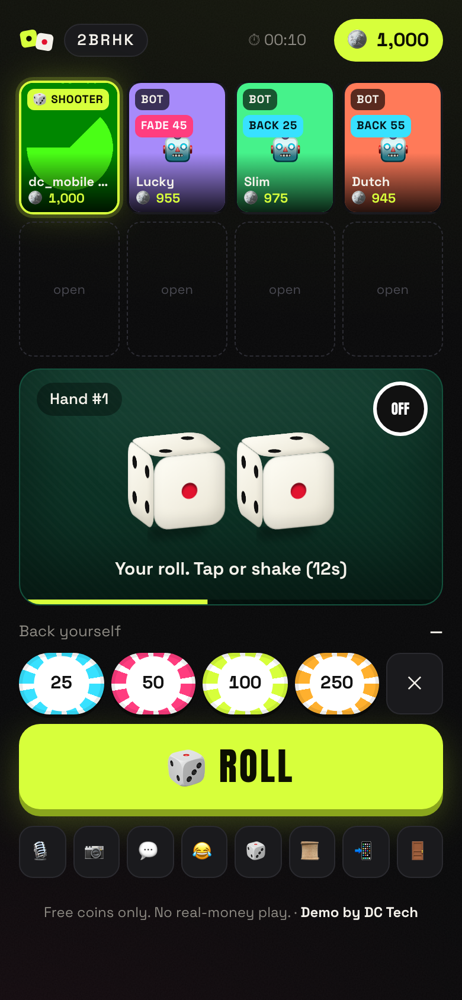
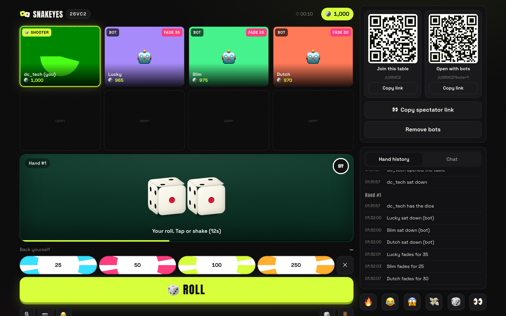

# SNAKEYES: live-video street dice

A working demo of a multiplayer street-dice (craps-style) table on real-time video. Up to 8 players sit at a table,
everyone's camera is live, the dice pass seat to seat, and every bet, roll, payout and "catch" dispute is refereed by
the server. Free coins only.

**Live:** https://dice-live-demo.vercel.app · open a table with bots: start one from the home page, or use any `…/r/<CODE>?bots=1` link.

| 390 px phone | Desktop |
|---|---|
|  |  |

<sub>The green shape in the camera tiles is Chrome's fake webcam used by the automated tests.</sub>

---

## Architecture

```
 Browser (Next.js app router, React 19)                       Vercel
 ┌──────────────────────────────────────────┐   POST /api/token   ┌─────────────────────────────┐
 │ LiveKit room (video, audio, chat, emoji) │ ──────────────────▶ │ route handler: verifies the │
 │                                          │ ◀── LiveKit JWT ─── │ Supabase session, mints a   │
 │ Table UI ── reads ──▶ Supabase (RLS)     │                     │ room-scoped token. The API  │
 │          ◀─ realtime ─ rooms/seats/events│                     │ secret never leaves here.   │
 │          ── writes ─▶ RPC only ──┐       │                     └─────────────────────────────┘
 │ DiceAdapter: Virtual | GoDiceWeb │       │
 └──────────────────────────────────┼───────┘
                                    ▼
             Supabase Postgres: the game engine
 ┌───────────────────────────────────────────────────────────────────────────┐
 │ public.* RPCs (SECURITY DEFINER): sign_in, create_room, join_room,         │
 │   place_bet, roll_dice, call_catch, vote_catch, leave_room, heartbeat, …   │
 │   → engine.do_*: lock room row, validate identity / seat / turn / phase /  │
 │     balance / daily cap, mutate, append to events (hand history)           │
 │ engine.tick_room: resolves every deadline on the DB clock (catch window,   │
 │   catch vote, shot clock, disconnect, seat hold), drives bots              │
 │ pg_cron: engine.tick_all() every second (+ lazily on every RPC/heartbeat)  │
 │ RLS: SELECT only for clients. No INSERT/UPDATE/DELETE grants at all.       │
 └───────────────────────────────────────────────────────────────────────────┘
```

* **Video:** LiveKit Cloud with `livekit-client` and `@livekit/components-react`. Tokens are minted in
  `src/app/api/token/route.ts`, and the caller must present a valid Supabase session. Identity and display name come from
  the database, not the request. Spectator tokens (`?watch=1`) have `canPublish: false`: no camera, no mic, chat and
  reactions only. Chat and emoji reactions travel over LiveKit data channels.
* **Game state:** Supabase Postgres, in `supabase/migrations/20261103000100_snakeyes_engine.sql`. Clients subscribe to
  Realtime changes on `rooms`, `seats` and `events`, and refetch with plain RLS-guarded selects.
* **Rules:** `src/lib/rules.ts` is the single TypeScript rules module the UI uses. The server's copy is in SQL
  (`rules_resolve_roll`, `rules_settle_bet`, `rules_catch_verdict`, `rules_config`). A parity test runs every input
  through both and fails on any disagreement.

## Why server-authoritative

In a betting game, any state the client can write is state a cheater can write. So:

* **Clients never write tables.** RLS gives `anon` and `authenticated` users SELECT only, and all
  INSERT/UPDATE/DELETE privileges are revoked. The tests prove a signed-in client can't touch `players.balance`,
  `rooms.phase_deadline`, `bets` or `events` directly.
* **Every action is a Postgres function** that takes a row lock on the room, then checks who you are, whether you're
  seated, whose turn it is, the phase, your balance and your daily cap. All of that happens in one transaction, so
  two people acting at once can't both win a race.
* **Virtual dice are rolled by the database** (`engine.die()`: `gen_random_bytes` plus rejection sampling, so faces
  are exactly uniform). The client only says "roll". Faces it sends with a virtual roll are ignored, and a test
  checks this.
* **Timers belong to the server.** Every deadline (5 s catch window, 6 s catch vote, 25 s shot clock, 8 s disconnect
  detection, 30 s seat hold) is stored in the database and resolved by `engine.tick_room()` against `now()`. pg_cron
  ticks every second. Heartbeats and RPCs can also trigger a tick, but a tick only compares deadlines to the database
  clock, so no client can extend or skip a timer.
* **Bots use the same doors.** Bots call the same `engine.do_bet / do_roll / do_call_catch / do_vote` functions as
  people, with the same validation. They agree to about 50% of catch calls, so a solo player at a table of bots can
  win a catch vote.

## The game

* Up to 8 seats. The shooter rotates in seat order, and away seats are skipped.
* Players start with 1,000 free coins. Before each roll, players **fade** (bet against) or **back** the shooter, one
  side per hand. The shooter can only back themselves. Stakes leave the balance when placed and **lock when the roll
  starts**. Payouts are even money.
* Come-out: 7 or 11 wins; 2, 3 or 12 loses (craps); anything else becomes the point. In the point phase the shooter
  rolls until they hit the point (win) or a 7 (seven-out).
* **Catch:** for 5 s after a roll, any other seated player can call catch (off the table, cocked, bad throw). The other
  seated players vote. A strict majority voids the roll, the shooter rerolls, and stakes stay locked. Votes close at
  a server deadline, where non-voters count as no. Every call, vote and verdict goes into hand history.
* **Disconnects:** a missed heartbeat for 8 s marks the seat *away* and holds it for 30 s, with a countdown on the
  tile. If the shooter is gone, the turn auto-skips; an unfinished hand is voided and its bets refunded. Rejoining
  the same table restores the same seat and balance.
* **Hand history:** every roll, bet, payout, refund and catch, with timestamps.
* **Play limits:** a visible session timer, and a configurable daily coin-play cap per user (500–10k, enforced in
  `engine.do_bet` and reset at midnight US Central). A gentle reminder sheet appears every 20 minutes (`?remind=<sec>`
  shortens this for demos), at 80% of the cap, and when the cap is hit.

## Dice adapters (and how they map to the native SDKs)

`src/lib/dice/adapter.ts` defines one interface: `connect()`, `onRollStart()`, `onRoll(intent)` and `onState()`.
The table only ever sees a `RollIntent`:

| Adapter | Where | Emits |
|---|---|---|
| `VirtualDice` | everywhere | `{ source: "virtual" }` on a tap or a shake (DeviceMotion; iOS asks permission first). The server picks the faces. |
| `GoDiceWeb` | Chrome on Android and desktop (Web Bluetooth) | `{ source: "godice", d1, d2 }` once both dice tumble and settle flat |
| *(native)* `GoDiceNative` | iOS / Android app | the same `RollIntent`, from the GoDice mobile SDKs |

`GoDiceWeb` is written against Particula's documented JavaScript API: one `GoDice` instance per die,
`requestDevice()`, and the `onDiceConnected / onRollStart / onStable / onTiltStable / onFakeStable / onBatteryLevel /
onDiceDisconnected` callbacks. It assembles a two-die throw and treats **`onTiltStable` (a cocked die) and
`onFakeStable` (a die placed by hand) as invalid throws** before they reach the table. That's the hardware version of
the catch rule. It's unit-tested against a mock of the SDK (`src/lib/dice/godice.test.ts`).

* **iOS Safari has no Web Bluetooth**, so the web adapter reports *unsupported* there, and the app explains that the
  native iOS app uses the GoDice iOS SDK.
* The native SDKs expose the same events (roll started, stable, tilt-stable, fake-stable, battery, colour). A
  `GoDiceNative` adapter in React Native is a thin native-module bridge that emits the same `RollIntent`. Nothing above
  the adapter changes.
* **License:** Particula's API license doesn't allow redistributing `godice.js` or commercial use without their
  agreement. This demo doesn't bundle it: it loads the official file from Particula's public repo at runtime, only
  when a player taps "Connect dice". A shipping product needs a commercial agreement with Particula.
* **Trust model:** physical dice report their own faces, so a hacked client could lie. That's why physical rolls are
  labelled "(GoDice)" in history, why the catch vote exists, and why production adds the hardening listed below.

## What the production React Native version would change

* **App:** Expo / React Native with `@livekit/react-native` and `@livekit/react-native-webrtc`. The tile grid,
  bet bar and felt port directly; the Supabase calls are identical.
* **Auth:** phone number + SMS OTP through a proven provider (Supabase Auth with Twilio Verify, or similar), plus
  device binding. The demo's username sign-in (an anonymous Supabase session plus a claimed name) exists only to keep
  the demo friction-free.
* **Dice:** a `GoDiceNative` adapter over the GoDice iOS/Android SDKs (Bluetooth LE, background reconnection), using
  the interface above. Also: pin each die's ID to the seat for the session, reject rolls without a preceding
  roll-start, and flag statistically impossible streaks server-side.
* **Engine:** the same Postgres functions. At scale, pg_cron's 1 s tick moves to a dedicated worker (or a Supabase
  Edge Function on a queue) that wakes exactly at each room's next deadline, and hand history moves to a partitioned,
  append-only table.
* **Video:** simulcast tuned for 8 tiles, active-speaker layout, server-side recording of disputed rolls (LiveKit
  Egress) so a catch can be reviewed, plus moderation and reporting.
* **Responsible play:** cooldowns on raising the daily cap, self-exclusion, age gating and store-policy review. Coins
  stay free and non-redeemable.

## Run it

```bash
cp .env.example .env.local        # LiveKit + Supabase values (never committed)
npm install
supabase start                    # local Postgres + auth + realtime (ports 553xx)
npm run dev
```

Apply the engine to a hosted project with `supabase db query --linked -f supabase/migrations/…sql` (or `supabase db push`).
Anonymous sign-ins must be enabled (`supabase/config.toml` → `enable_anonymous_sign_ins = true`, then `supabase config push`).

| Env var | Where | Notes |
|---|---|---|
| `LIVEKIT_URL`, `LIVEKIT_API_KEY`, `LIVEKIT_API_SECRET` | server only | used by `/api/token` |
| `NEXT_PUBLIC_SUPABASE_URL`, `NEXT_PUBLIC_SUPABASE_ANON_KEY` | client | safe to expose: RLS + RPC grants do the guarding |
| `SUPABASE_SERVICE_ROLE_KEY` | local only | not needed by the app and not deployed |

## Tests

```bash
npm test               # unit: rules + GoDice adapter (mocked SDK) + DB: Postgres functions on local Supabase
npm run test:e2e       # Playwright, two browser contexts with Chrome's fake camera/mic
BASE_URL=https://dice-live-demo.vercel.app npm run test:e2e   # against the live deployment
```

* **Unit (44):** come-out and point resolution, payouts, catch majority maths, rotation, bet validation, and the
  GoDice adapter (pairing, two-die throw assembly, cocked/fake-stable rejection, one-die timeout, picker cancel,
  disconnect).
* **Postgres functions (28):** read-only RLS, turn order, payouts, stake locking, validation, server-generated dice
  and their uniformity, catch voting (majority, early reject, deadline close, window, bots voting), disconnect hold,
  rejoin, release, shooter auto-skip, shot clock, untouchable deadlines, daily cap, hand history, and TS↔SQL rules parity.
* **E2E (3 scenarios × 390 px and desktop):** two players join one table and see each other's live video, bet, roll,
  call catch (the roll is voided and rerolled), then one disconnects (seat shows *away*) and rejoins to the same seat
  and balance. Solo with bots: bots bet and roll, QR codes render, a spectator can't bet. Play limits: cap set and
  enforced, reminders shown. Every test asserts **zero console errors**; the bots test also asserts layout shift < 0.05
  and no horizontal scroll at 390 px.

---

Free coins only. No real-money play. Fictional brand. **Demo by [DC Tech](https://dctechltd.com).**
